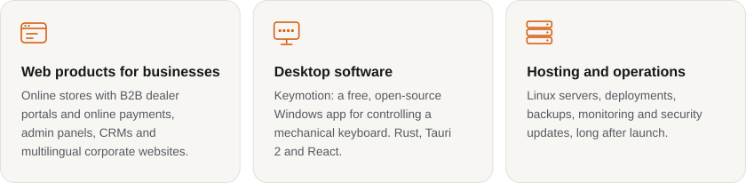
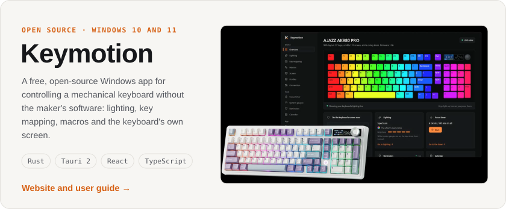
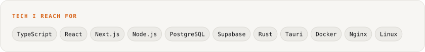

<picture>
  <source media="(prefers-color-scheme: dark)" srcset="assets/hero-dark.svg">
  
</picture>

I have been building websites, online stores and business software since 2015, first at digital agencies in Istanbul and, since 2023, as an independent developer. I take a product from the first conversation to production and keep it running after launch.

<picture>
  <source media="(prefers-color-scheme: dark)" srcset="assets/pipeline-dark.svg">
  
</picture>

<picture>
  <source media="(prefers-color-scheme: dark)" srcset="assets/cards-dark.svg">
  
</picture>

<a href="https://cebersaban44-rgb.github.io/keymotion/">
  <picture>
    <source media="(prefers-color-scheme: dark)" srcset="assets/keymotion-dark.svg">
    
  </picture>
</a>

<picture>
  <source media="(prefers-color-scheme: dark)" srcset="assets/stack-dark.svg">
  
</picture>

Most of my client work lives in private repositories. Keymotion is open source and pinned below. 
**[LinkedIn](https://www.linkedin.com/in/sabanceber)** · Open to full-stack roles in Kraków, hybrid or remote, and to contract work.
